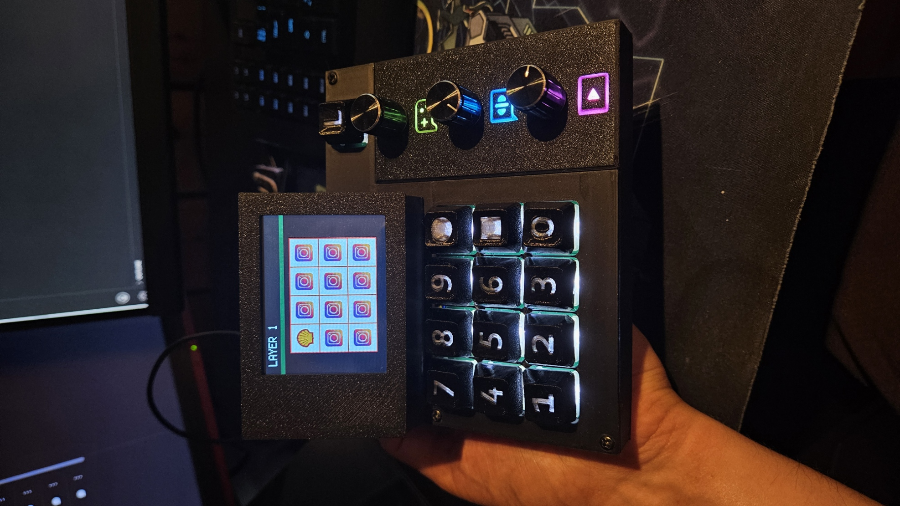
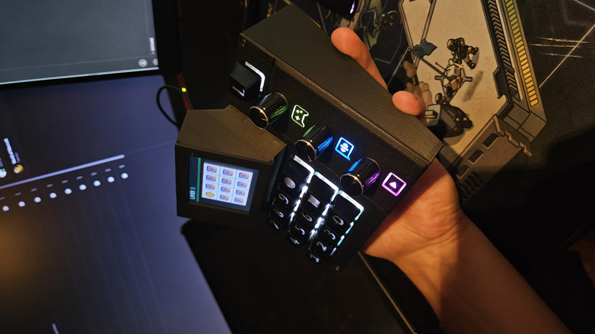
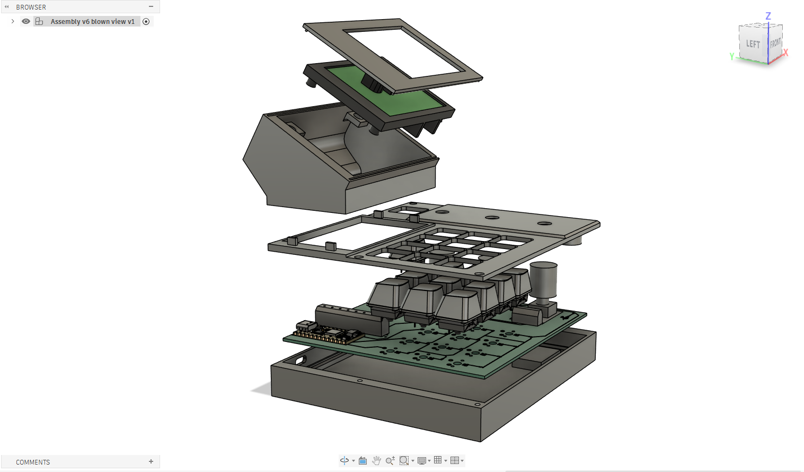

# Custom Macro Keypad

A custom-built programmable macro keypad featuring 12 mechanical keys, three rotary encoders, a dedicated layer button, and a color display.

The keypad is powered by an Adafruit KB2040 running CircuitPython and KMK firmware. It currently supports up to four configurable layers, allowing each key and encoder direction to perform a different action on every layer.

<p align="center">
  
  
</p>

<p align="center">
  
</p>

## Features

- 12 individually programmable mechanical keys
- Three programmable rotary encoders
- Dedicated layer-selection button
- Support for up to four configuration layers
- 320 × 240 color display
- Keyboard, media-key, macro, URL, application-launching, and MIDI actions
- Custom PCB
- Custom 3D-printable enclosure and keycaps
- Configurable display icons and layer names
- CircuitPython and KMK-based firmware

## Personal configuration

I currently use the three rotary encoders to control separate audio channels in SteelSeries GG Sonar. This is why the encoder logos on the chassit panel are what they are.

The encoder actions are programmable, and the encoder panel design can be modified using the included STEP or Fusion 360 files.

## Project structure

```text
Macro_keypad/
├── Board_Code/              CircuitPython and KMK firmware
├── Cad/                     Enclosure, keycap, and component models
├── Desktop_App/             Desktop configuration app in development
├── Macro_Keyboard_Circuit/  KiCad schematic and PCB files
└── images/                  README photographs and renders
```

## Firmware configuration

OBS! The config file is automatically configured using the desktop app
Key and encoder actions are configured in:

```text
Board_Code/active_config.py
```

A basic key assignment looks like this:

```python
"KC.A"
```

Modifier combinations can be written directly:

```python
"KC.LCTRL(KC.C)"
"KC.LCTRL(KC.LSHIFT(KC.S))"
```

Other supported actions include:

```python
"KC.VOLU"
"KC.VOLD"
"URL:https://www.youtube.com/"
"LAUNCH:C:/Program Files/KiCad/10.0/bin/kicad.exe"
```


Each layer contains 12 key assignments. The three encoders have separate assignments for counterclockwise rotation, clockwise rotation, and their push-button action where applicable.

### Using the `MACRO:` wrapper

Use the `MACRO:` wrapper when one button should perform several actions, type text, include a delay, or behave differently when pressed, held, and released. Separate each part of a macro with `|`.

The supported macro commands are:

- `TEXT:` types text.
- `TAP:` presses and immediately releases a key or shortcut.
- `PRESS:` holds a key down.
- `RELEASE:` releases a held key.
- `DELAY:` waits for the specified number of milliseconds.

For example, this macro copies, waits 100 milliseconds, and then pastes:

```python
"MACRO:TAP:KC.LCTRL(KC.C)|DELAY:100|TAP:KC.LCTRL(KC.V)"
```

A key action without an explicit event prefix runs when the button is pressed i.e. `ON_PRESS:`. The optional event prefixes are:

- `ON_PRESS:` runs when the button is pressed.
- `ON_HOLD:` runs while the button is held.
- `ON_RELEASE:` runs when the button is released.

For example:

```python
"MACRO:ON_PRESS:TEXT:start|ON_HOLD:TAP:KC.A|ON_HOLD:DELAY:100|ON_RELEASE:TEXT:end"
```

Simple shortcuts do not require the macro wrapper and can be assigned directly, as shown above.

## Display icons

Icons are stored by layer and key number inside:

```text
Board_Code/images/
```

The desktop app has the feature to prepare images for the keypad display.


## CAD files

The `Cad` directory contains editable and printable files for the enclosure and keycaps, including:

- Fusion 360 files
- STEP models
- STL files
- 3MF print files
- Component reference models

The encoder logos can be edited to create a personalized panel.

## Desktop application

A PySide6 desktop application is currently in development.

The planned application will provide a graphical interface for:

- Editing key and encoder assignments
- Creating and managing profiles
- Changing layer names and display icons
- Sending configurations to the keypad
- Executing Windows-specific actions that cannot run directly on the board

At the moment, configuration is performed by editing `active_config.py` manually.

## Hardware

- Adafruit KB2040 with RP2040
- 12 mechanical keyboard switches
- Three rotary encoders
- ST7789-based 320 × 240 LCD
- Custom-designed PCB
- 3D-printed enclosure and keycaps

The gerber files for the PCB is found under `Macro_Keyboard_Cicuit`, for manufacturing I used [JLCPCB.com](https://jlcpcb.com/?from=VGEEEPCB1&utm_source=google&utm_medium=cpc&utm_campaign=23630608026&utm_content=803328468424&utm_term=p_pcb%20manufacturing&adgroupid=194779815580&utm_network=g_&gad_source=1&gad_campaignid=23630608026&gbraid=0AAAAApXmXsdJ7AZJWkuDSiIHlBB-qUlTP&gclid=CjwKCAjwvsvTBhBaEiwAmf-3njncny4jFNF5munrN3aUFo6y1D-hInMBf39UMtHOZ52Y8qgtHUBPVxoC710QAvD_BwE). Since the PCB is only two sided it is possible to manufacture by yourself if you have acess to the equipment. 

## Project status

This project is under active development. The keypad firmware, PCB, enclosure, display, keys, and encoders are functional. The desktop configuration application is still being developed.

## License

No license has been selected yet.
